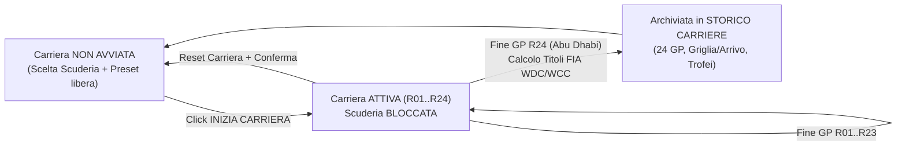

# PIANO B *(ex PIANO MODIFICHE PRE STEP 3)*

## Obiettivo
Eseguire integralmente le 5 macro-richieste di [prompt-modifiche-random.md](../PROMPT/prompt-modifiche-random.md):
1. Rimozione completa (UI + codice) del sistema soldi/valuta e upgrade/garage, più rimozione solo grafica di `"meteo carriera..."`.
2. Ciclo di vita completo della Carriera (Avvio esplicito, Blocco Scuderia in corso, Reset con conferma, Storico Carriere concluse con anteprima simulata).
3. Sezione **Stanza dei Trofei 3D (Museo Luminoso)** con Corridoio dei Piedistalli (Coppa del Mondo FIA), Sala Muro Trofei 24 GP su 3 scaffali con targhette (Griglia + Arrivo + Premi F1) e indicazione esplicita della scuderia vincitrice nello Storico.
4. `TEAM SELECT` con nuova parete **Showroom Museo Chiaro 3D** al posto dello sfondo poligonale `#f1-lowpoly-bg` e rimozione dei 2 tasti sotto i piloti.
5. `TRACK SELECT` con pannello orizzontale compatto ancorato in basso sopra il carosello, informazioni sopra la mappa in primo piano e vista pista 3D sullo sfondo libera.

---

## Decisioni Confermate

- **Rimozione totale Upgrade/Economia:** eliminati `CarSpecs.js`, `Auto Base / Auto MAX` (Prove Libere), `Bonus Carriera €` (Impostazioni → Fisica) e tutta la sezione `GARAGE & UPGRADE`, il cui slot di navigazione viene riutilizzato per **`TROFEI & STORICO`**.
- **Ciclo di vita Carriera:** **1 Carriera = 1 Stagione completa (24 GP)**. Dopo `R24` la Carriera si conclude e viene archiviata nello **Storico Carriere**; **Reset Carriera** (con modale di conferma) cancella la stagione attiva senza salvarla nello storico.
- **Blocco Scuderia:** con Carriera attiva, la scuderia Carriera è bloccata (Home e Profilo), mentre `TEAM SELECT` rimane utilizzabile per scegliere scuderia/pilota nelle modalità **Sessione Rapida / Prove Libere / Multiplayer**.
- **Set Ufficiale F1 Completo:** *Pirelli Pole Position Award* (Qualifiche Q3), Podio GP `1°/2°/3°`, *DHL Fastest Lap Award* (Giro Veloce Gara) e Titoli Mondiali FIA `WDC` / `WCC` a fine stagione.
- **Showroom 3D (`TEAM SELECT` & Stanza Trofei 3D):** **Showroom Museo Chiaro** (pannelli bianco perla satinato, profili verticali neri minimalisti, lucernari a soffitto 3×2, cemento architettonico PBR e fascia/insegna dinamica della scuderia).
- **`TRACK SELECT`:** fascia orizzontale compatta in basso subito sopra il carosello circuiti.

---

## Flusso Stati Carriera (`v3`)

---

## Stato Avanzamento Step

- **Step 1 — Rimozione Sistema Soldi, Upgrade & `CarSpecs.js` + Pulizia Grafica `"meteo carriera..."`:** **COMPLETATO** (`CarSpecs.js` eliminato, fisica normalizzata a `1.0×`, `skyPresetId: 'random'` preservato).
- **Step 2 — Carriera `v3`, Premi Reali F1 & Storico Carriere:** **COMPLETATO** (`src/career/F1Awards.js`, `src/career/CareerStorage.js` v3, `playerGridPosition` propagato da `WorldState.js` → `main.js` → `HudOverlay.js`).
- **Step 3 — UI Home Carriera, Blocco Scuderia, Reset & Stanza dei Trofei 3D (Museo Luminoso):** **COMPLETATO** (`scripts/blender/build_f1_trophies.py`, 8 modelli PBR `.glb` in `public/assets/3d/models/trophies/`, `src/rendering/TrophyMuseumScene3D.js`, `SceneManager.js`, `MenuManager.js`, `index.html`, `main.js`).
- **Step 4 — `TEAM SELECT` Showroom Museo Chiaro 3D + Pulizia 2 Tasti Piloti:** *Da fare.*
- **Step 5 — `TRACK SELECT` Pannello Orizzontale Compatto in Basso:** *Da fare.*
