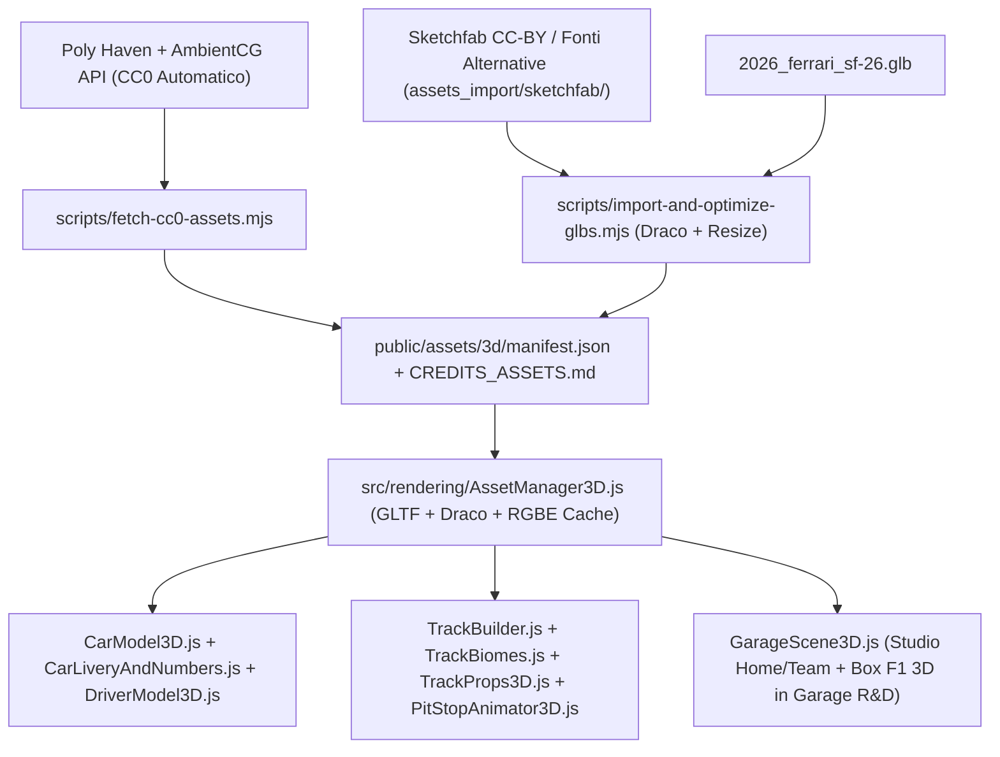

# PIANO GRAFICA 3D — Upgrade Asset 3D Ad Alta Risoluzione (Monoposto 2026, Piloti, Natura, Piste PBR, Garage 3D & Pit Lane/Box 24 Piste)

## Goal Description

Sostituire i modelli procedurali e la livrea unica condivisa con **asset 3D ad alta risoluzione** coerenti con [2026_ferrari_sf-26.glb](../2026_ferrari_sf-26.glb), preservando la fisica 1:1 delle 24 piste FIA e la fluidità a **60 FPS**, e producendo alla fine un **report completo** su ciò che è stato sostituito e ciò che non è stato trovato o richiede download manuale.

Scelte confermate tramite `/grill-me`:
1. **Fonti ibride**: ricerca e link diretti per i migliori GLB gratuiti su **Sketchfab** (che richiedono login per scaricare il `.glb`) + download e integrazione **automatica immediata** da siti CC0 aperti (**Poly Haven**, **AmbientCG**).
2. **11 Scuderie + 22 Numeri Pilota**: caricamento multi-modello compresso (Draco + texture ottimizzate per 60 FPS) con slot drop-in per ciascuna delle 11 scuderie + **scocca F1 2026 pulita** (senza decal Ferrari Shell/HP/44) con livrea ufficiale come fallback immediato + **decal 3D dinamica del numero pilota (`#1..#87`)** su muso e cofano motore per tutti i 22 piloti.
3. **24 Piste Realistiche + Natura per Bioma**: geometria fisica 1:1 delle spline FIA invariata + upgrade completo con **texture PBR 2K** (asfalto da corsa con normal/roughness e gommatura, erba/ghiaia/sabbia, cordoli e barriere), **cielo e riflessi HDRI**, **alberi/cespugli/rocce 3D GLB istanziati per bioma** (parco europeo, costiero/tropicale, deserto/notte, cittadino) e **strutture 3D a bordo pista** (tribune, pit building, catch-fence FIA, torri faro, portale partenza).
4. **Corpi dei Piloti 3D**: pilota 3D completo seduto nell'abitacolo (tuta tinta col colore scuderia, collare HANS, braccia e guanti posizionati sul volante e animati con la sterzata, casco dettagliato con visiera per ciascuno dei 22 piloti; testa/casco nascosti in visuale `Prima persona`).
5. **Garage F1 3D**: box F1 3D realistico dedicato alla schermata **`GARAGE & UPGRADE`** (con pareti box, gantry luci, rack gomme, monitor telemetria, attrezzatura R&D e limiti orbita anti-clipping), mantenendo lo studio dark-luxury riflettente pulito in `HOME` e `TEAM SELECT`.
6. **Pit Lane, 11 Box Scuderie & Meccanici Pit Stop 3D (24 Piste)** *(aggiunto da `PIANO PRE STEP 4`)*: sostituzione dei placeholder strutturali di pit lane, 11 box scuderie e meccanici pit stop su tutte le 24 piste con modelli 3D ad alta definizione ricercati su **Sketchfab** (o cataloghi alternativi CC0/CC-BY se non presenti su Sketchfab).

---

## User Review Required

> [!IMPORTANT]
> **Download da Sketchfab vs Download Automatico CC0:**
> - **Poly Haven** e **AmbientCG** (texture PBR 2K, HDRI, alberi 3D, erba/rocce 3D, prop officina e bordo pista) sono **100% CC0** e verranno scaricati e integrati **automaticamente** durante l'esecuzione degli step.
> - **Sketchfab** espone gratuitamente ricerca e metadati, ma **il download dei file `.glb` richiede un account Sketchfab autenticato**. Nel progetto è presente la cartella drop-in `assets_import/sketchfab/` con lo script automatico `scripts/import-and-optimize-glbs.mjs`: non appena scaricherai i `.glb` dai link ufficiali in tabella, lo script li normalizzerà, comprimerà con Draco (~85% più leggeri) e li attiverà automaticamente nell'app.
> - **Scoperta chiave su Sketchfab:** l'autore **`Tyler_Dave`** ha pubblicato **9 delle 11 monoposto F1 2026** (stessa identica famiglia, scala e dettaglio ~260k–281k triangoli della `2026_ferrari_sf-26.glb`, tutte gratuite **CC Attribution**!). Per le uniche 2 scuderie 2026 non pubblicate da `Tyler_Dave` (**Alpine** e **Racing Bulls**), sono stati individuati i modelli 2025 gratuiti (`Alpine A525`, `VCARB 02`) oltre alla scocca 2026 pulita.

> [!WARNING]
> **Ottimizzazione Prestazioni (60 FPS su 22 vetture):**
> Il solo file `2026_ferrari_sf-26.glb` originale pesa **31,2 MB** (272.038 triangoli, 33 texture non compresse). Caricare 11 GLB non compressi porterebbe il peso oltre **340 MB** saturando la VRAM del browser.
> Lo **Step 1** ha introdotto `DRACOLoader` e la pipeline di ottimizzazione per ridurre ogni monoposto a **~2,5–4,5 MB** mantenendo alta qualità visiva, più caricamento lazy/asincrono per scuderia.

> [!NOTE]
> **Attribuzioni Licenze (`CREDITS_ASSETS.md`):**
> Tutti i modelli Sketchfab individuati sono **CC Attribution** (o CC-BY-NC-SA) e gli asset Poly Haven / AmbientCG sono **CC0**. Ogni risorsa integrata è tracciata in [CREDITS_ASSETS.md](../CREDITS_ASSETS.md).

---

## Catalogo Verificato degli Asset 3D Trovati

### A. Monoposto delle 11 Scuderie F1 2026
| # | Scuderia 2026 | Modello Trovato | Fonte / Autore | Triangoli | Licenza | Acquisizione |
|---|---|---|---|---|---|---|
| 1 | **Scuderia Ferrari** | `2026 Ferrari SF-26` | Già locale ([2026_ferrari_sf-26.glb](../2026_ferrari_sf-26.glb)) | 272.038 | CC-BY | **Già compressa Draco** (`public/assets/3d/cars/ferrari.glb`) |
| 2 | **Red Bull Racing** | `2026 Redbull RB22` | Sketchfab / `Tyler_Dave` — [Link](https://sketchfab.com/3d-models/none-0a3d24a58e0549d591a5a48c22eec383) | 281.075 | CC-BY | Drop-in `red_bull.glb` (fallback pulito attivo subito) |
| 3 | **Mercedes-AMG** | `2026 Mercedes W17` | Sketchfab / `Tyler_Dave` — [Link](https://sketchfab.com/3d-models/none-b806f1e70aa343219e7158169549b97b) | 267.698 | CC-BY | Drop-in `mercedes.glb` (fallback pulito attivo subito) |
| 4 | **McLaren** | `2026 McLaren MCL40` | Sketchfab / `Tyler_Dave` — [Link](https://sketchfab.com/3d-models/none-96214ad5624f42a0861f77008f8d29e7) | 276.870 | CC-BY | Drop-in `mclaren.glb` (fallback pulito attivo subito) |
| 5 | **Aston Martin** | `2026 Aston Martin AMR26` | Sketchfab / `Tyler_Dave` — [Link](https://sketchfab.com/3d-models/none-a50d1c7bc086455c9412470d93fc3fc7) | 271.170 | CC-BY | Drop-in `aston_martin.glb` (fallback pulito attivo subito) |
| 6 | **Williams** | `2026 Williams FW48` | Sketchfab / `Tyler_Dave` — [Link](https://sketchfab.com/3d-models/none-4efa51e6d64a4192a83418f1b715c671) | 275.868 | CC-BY | Drop-in `williams.glb` (fallback pulito attivo subito) |
| 7 | **Haas F1 Team** | `2026 Haas VF-26` | Sketchfab / `Tyler_Dave` — [Link](https://sketchfab.com/3d-models/none-1f41e03886724bc6acd16c92402989bc) | 275.868 | CC-BY | Drop-in `haas.glb` (fallback pulito attivo subito) |
| 8 | **Audi F1 Team** | `2026 Audi R26` | Sketchfab / `Tyler_Dave` — [Link](https://sketchfab.com/3d-models/none-32bf228264b047669b100b0f1b8769ac) | 265.138 | CC-BY | Drop-in `audi.glb` (fallback pulito attivo subito) |
| 9 | **Cadillac F1 Team** | `2026 Cadillac MAC-26` | Sketchfab / `Tyler_Dave` — [Link](https://sketchfab.com/3d-models/none-95bcd37aa7c649779efc33b90b6c023e) | 259.719 | CC-BY | Drop-in `cadillac.glb` (fallback pulito attivo subito) |
| 10 | **Alpine** | `2025 Alpine A525` *(A526 2026 non trovato gratis)* | Sketchfab / `abuhossain844` — [Link](https://sketchfab.com/3d-models/none-5f029644bc2d4eaebbec88712ea46dfa) | 455.631 | CC-BY | Drop-in `alpine.glb` (o scocca 2026 pulita livrea Alpine) |
| 11 | **Racing Bulls** | `VCARB 02` (2025) *(VCARB 03 completo non trovato gratis)* | Sketchfab / `MattDoesBlender` — [Link](https://sketchfab.com/3d-models/none-caf594de23d541b091b2e814cd6a0d74) | 459.029 | CC-BY-NC-SA | Drop-in `racing_bulls.glb` (o scocca 2026 pulita livrea VCARB) |

### B. Corpi dei Piloti 3D (Seduti in Abitacolo)
| Risorsa | Modello / Strategia | Fonte | Triangoli | Licenza | Stato |
|---|---|---|---|---|---|
| **Pilota F1 Seduto + Casco Bell HP77** | `rhp_bell_hp77_driver_f1` | Sketchfab / `MattDoesBlender` — [Link](https://sketchfab.com/3d-models/none-2916ac047ea84abe9394c38e4fa2d4bd) | 60.714 | CC-BY-NC-SA | Drop-in `driver_f1.glb` |
| **Pilota Leggero (LOD Bot)** | `Race Car Driver` | Sketchfab / `tomkart` — [Link](https://sketchfab.com/3d-models/none-a8503189a20a441893b66e4c57d3231b) | 5.142 | CC-BY | Drop-in `driver_lod.glb` |
| **Pilota F1 Articolato High-Detail (Immediato)** | Modello 3D PBR integrato (tuta ignifuga tinta per team, HANS carbonio, cinture 6 punti, avambracci/guanti sul volante animati, casco aerodinamico con visiera per ciascuno dei 22 piloti) | Generato nativamente in `DriverModel3D.js` | ~4.200 | Interno/MIT | **Automatico immediato** |

### C. Alberi, Erba e Natura Circostante (100% Download Automatico CC0)
| Bioma / Ruolo | Asset Verificati | Fonte | Licenza | Stato |
|---|---|---|---|---|
| **Alberi Parco Europeo** (Monza, Spa, Austria, Silverstone, Hungaroring, Barcellona, Suzuka, Montreal, Interlagos, Melbourne) | `pine_tree_01`, `fir_tree_01`, `tree_small_02`, `jacaranda_tree` | **Poly Haven** | **CC0** | **Download automatico** |
| **Alberi Tropicali / Costieri** (Miami, Jeddah, Singapore, Zandvoort, Mexico) | `island_tree_01`, `island_tree_02` + opzionale Sketchfab `Realistic Palm Tree 4 Free` ([Link](https://sketchfab.com/3d-models/none-917c18d6b2d04d33950dea6e20bc074f), 8k tris) | **Poly Haven** + Sketchfab | **CC0** / CC-BY | **Download automatico** (+ palma drop-in) |
| **Cespugli, Erba 3D e Rocce** | `grass_medium_01`, `grass_bermuda_01`, `fern_02`, `shrub_sorrel_01`, `rock_moss_set_01`, `boulder_01`, `namaqualand_boulder_02` | **Poly Haven** | **CC0** | **Download automatico** |
| **Texture Terreno PBR 2K** (Erba reale, Ghiaia, Sabbia) | `Grass004` / `Grass005` (**AmbientCG**) + `gravelly_sand`, `sandy_gravel_02`, `coast_sand_01` (**Poly Haven**) | **AmbientCG** + **Poly Haven** | **CC0** | **Download automatico** |

### D. Pista Realistica & Strutture Bordo Pista (Download Automatico CC0)
| Componente Pista | Asset Verificati | Fonte | Licenza | Stato |
|---|---|---|---|---|
| **Asfalto da Corsa PBR 2K** (Albedo + Normal + Roughness) | `asphalt_track` (custom Monza PBR), `asphalt_pit_lane` | Custom + **Poly Haven** | **CC0** | **Completato** |
| **Cemento, Muretti, Ponti e Barriere PBR 2K** | `concrete_floor_worn_001`, `concrete_wall_007`, `metal_plate`, `corrugated_iron` | **Poly Haven** | **CC0** | **Completato** |
| **Cielo & Riflessi HDRI** (9 Pure Skies 2K) | Catalogo 9 Pure Skies 2K in `SkyPresets.js` + `studio_small_09` | **Poly Haven** | **CC0** | **Completato** |
| **Prop 3D Bordo Pista** | `street_lamp_01` (torri faro), `modular_chainlink_fence` (catch-fence FIA), `power_box_01`, `Barrel_01` + tribune coperte e portale partenza PBR (drop-in opzionale `Starting Line` [Link](https://sketchfab.com/3d-models/none-ecb35b3e5b424f9dbf54174e6c5907de)) | **Poly Haven** + moduli 3D PBR | **CC0** | **Da integrare nello Step 3** |

### E. Garage F1 3D (`GARAGE & UPGRADE`)
| Componente Garage | Asset Verificati | Fonte | Licenza | Stato |
|---|---|---|---|---|
| **Box F1 3D PBR + Attrezzatura Officina Reale** | Pareti box F1 (`concrete_floor_painted`, `factory_wall`), gantry LED team, rack gomme Pirelli, monitor telemetria R&D + prop **Poly Haven** (`metal_tool_chest`, `steel_frame_shelves_01`, `power_box_01`, `modular_industrial_pipes_01`, `Drill_01`, `security_camera_01`, `studio_small_09.hdr`) | **Poly Haven** + moduli Box PBR | **CC0** | **Download & integrazione automatica immediata** |
| **Box F1 Completo (Drop-in Sketchfab)** | `F1 Garage` (16k tris, [Link](https://sketchfab.com/3d-models/none-6b2a72503e4249d3a4cc25f86d206dac)) o `Red Bull F1 Garage` (271k tris, [Link](https://sketchfab.com/3d-models/none-086dda7566f64c6c930354687e2ec274)) | Sketchfab | CC-BY | Drop-in `garage_f1.glb` |

### F. Pit Lane 3D, Box delle 11 Scuderie & Meccanici Pit Stop (Tutte le 24 Piste — Integrato con `PIANO PRE STEP 4`)
| Componente Pit Lane / Box | Strategia di Ricerca & Modelli | Fonte Primaria / Alternativa | Licenza | Stato |
|---|---|---|---|---|
| **Pit Building & 11 Box Scuderie ad Alta Definizione (24 Piste)** | Sostituzione dei box placeholder strutturali del `PIANO PRE STEP 4` con moduli garage F1 dettagliati (saracinesche, pareti tecniche, LED/insegne livrea per tutte le 11 scuderie, gantry luci sopra lo stallo, muretto pit wall con postazioni ingegneri e monitor) | **Sketchfab** (primaria) → fallback **Poly Haven / AmbientCG / Quaternius / BlenderKit CC0 / CGTrader-TurboSquid Free** se assenti su Sketchfab | CC-BY / CC0 | *Da ricercare e integrare nello Step 7* |
| **Meccanici Pit Stop & Cavalletti (Jack) 3D** | Sostituzione dei meccanici/jack placeholder di `PitStopAnimator3D.js` con modelli 3D dettagliati (tuta colore team, casco, pistola avvitatrice, front/rear jack animabili) | **Sketchfab** (primaria) → fallback cataloghi 3D CC0/CC-BY alternativi | CC-BY / CC0 | *Da ricercare e integrare nello Step 7* |

---

## Architettura della Pipeline Asset 3D

---

## Proposed Changes (Step-by-Step)

### Step 1 — Infrastruttura Asset 3D, Loader Draco/HDRI e Download Automatico CC0 *(COMPLETATO)*
- `src/rendering/AssetManager3D.js`, `scripts/fetch-cc0-assets.mjs`, `scripts/import-and-optimize-glbs.mjs`, `public/draco/`, `public/assets/3d/manifest.json`, `CREDITS_ASSETS.md`.

---

### Step 2 — Pista Realistica PBR 2K + Cielo & Riflessi HDRI (24 Circuiti) *(COMPLETATO)*
- `src/tracks/TrackBiomes.js`, `src/tracks/TrackBuilder.js`, `src/rendering/SceneManager.js` (+ `PIANO SUB-STEP 2` Step 1–4 completati).

---

### Step 3 — Alberi 3D, Erba/Natura per Bioma e Strutture Bordo Pista 3D
#### [NEW] `src/tracks/TrackProps3D.js` & [MODIFY] `src/tracks/TrackBuilder.js`
- Sostituzione dei coni verdi in `addParkTrees()` con `THREE.InstancedMesh` dei modelli GLB 3D reali per bioma (alberi, cespugli, ciuffi d'erba 3D, rocce) + Tribune coperte, Catch-fence FIA, Torri faro accese sui GP notturni e Portale partenza PBR.
- Verifica tramite `queryTrackSurface()` su ogni istanza per garantire zero collisioni con pista, cordoli, pit lane e barriere su tutte le 24 piste.

---

### Step 4 — Monoposto di Tutte le 11 Scuderie + Decal 3D Numeri Pilota (`#1..#87`)
#### [NEW] `src/cars/CarLiveryAndNumbers.js`
- Generatore di decal `CanvasTexture` ad alta risoluzione con numero ufficiale del pilota (`#1..#87`) applicato su muso e pinna/cofano motore di tutte le 22 vetture + livree pulite per team senza decal Ferrari (`sf25_decals`, `sf25_decals2`, `numbers` nascosti sulle scuderie non-Ferrari quando usano il fallback).

#### [MODIFY] `src/cars/CarModel3D.js`, `src/rendering/SceneManager.js` & `src/rendering/GarageScene3D.js`
- Registry multi-team `Map<teamId, CarTemplate>`: carica automaticamente il GLB dedicato di ogni scuderia presente in `manifest.json` (normalizzando passo 3.40 m, larghezza 1.90 m, 4 ruote e volante) e usa la scocca F1 2026 pulita per gli altri team.

---

### Step 5 — Corpi dei Piloti 3D nell'Abitacolo
#### [NEW] `src/cars/DriverModel3D.js` & [MODIFY] `src/cars/CarModel3D.js`
- Pilota 3D completo seduto nell'abitacolo (tuta Nomex tinta per scuderia, collare HANS, cinture, avambracci/guanti agganciati al volante che seguono `steerAngle`, casco F1 con visiera colorato per ciascuno dei 22 piloti; gruppo testa nascosto in visuale `Prima persona`; supporto drop-in automatico per `driver_f1.glb`).

---

### Step 6 — Garage F1 3D Realistico (`GARAGE & UPGRADE`) + Report Finale
#### [MODIFY] `src/rendering/GarageScene3D.js`
- Separazione tra `studioGroup` (`HOME` / `TEAM SELECT`) e `pitBoxGroup` (`GARAGE & UPGRADE`): Box F1 3D PBR con pavimento lucido, pareti tecniche e LED col colore team, rack gomme Pirelli, monitor telemetria R&D + prop reali Poly Haven (o `garage_f1.glb` se importato) e limiti orbita anti-clipping.

---

### Step 7 — Sostituzione Pit Lane, 11 Box Scuderie & Meccanici Pit Stop con Modelli 3D Dettagliati (Tutte le 24 Piste)
#### [MODIFY] `src/tracks/TrackBuilder.js`, `src/rendering/PitStopAnimator3D.js`, `scripts/import-and-optimize-glbs.mjs` & `public/assets/3d/manifest.json`
- **Ricerca modelli 3D ad alta definizione** su **Sketchfab** (e, qualora non fossero presenti o compatibili su Sketchfab, su cataloghi alternativi gratuiti CC0/CC-BY come Poly Haven, AmbientCG, Quaternius, BlenderKit CC0, CGTrader/TurboSquid Free) per:
  - **Pit lane completa e muretto pit wall 3D** (postazioni ingegneri, monitor, gantry luci ingresso/uscita e cartelli `60` / `80` 3D).
  - **11 Box Scuderie 3D dettagliati** su **tutte le 24 piste del calendario**, personalizzati per ciascuna scuderia (`F1_2026_TEAMS` + loghi ufficiali e numeri pilota), istanziati e compressi in Draco+WebP per mantenere i `60 FPS` senza alterare le coordinate/collisioni di `PitLaneGeometry.js`.
  - **Meccanici Pit Stop 3D e cavalletti (jack)** a sostituzione dei placeholder di `PitStopAnimator3D.js`.
- Registrazione negli slot opzionali `models.pitlane` di `public/assets/3d/manifest.json` (zero 404, fallback automatico ai placeholder strutturali di `PIANO PRE STEP 4`) e aggiornamento di [CREDITS_ASSETS.md](../CREDITS_ASSETS.md).

---

## Verification Plan

### Automated Tests
1. `npm.cmd run build` (verifica assenza errori Vite e gestione asset in `public/assets/3d/` e `public/draco/`).
2. Script di verifica asset 3D (`manifest.json`, risoluzione 11 scuderie / 22 numeri pilota, clearance alberi/prop e pit lane 3D sulle 24 piste).
3. `graphify update .` dopo ogni step di modifica codice.

### Manual Verification
- Verifica nel browser a `1280×720` (`ignoreCache: true`) con `0` errori console e `0` richieste HTTP `>= 400`.
